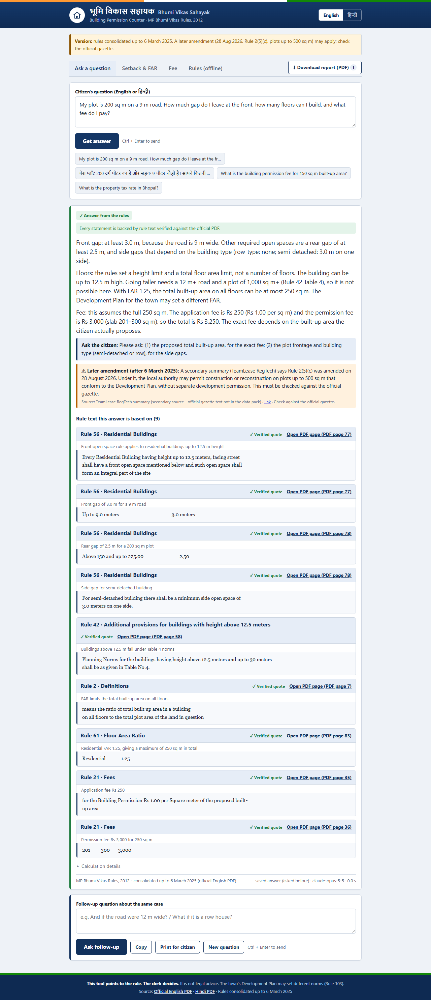
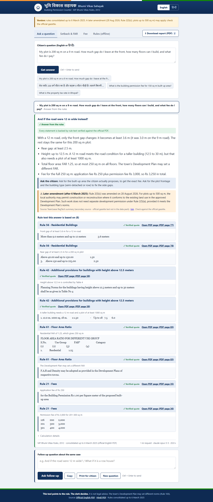
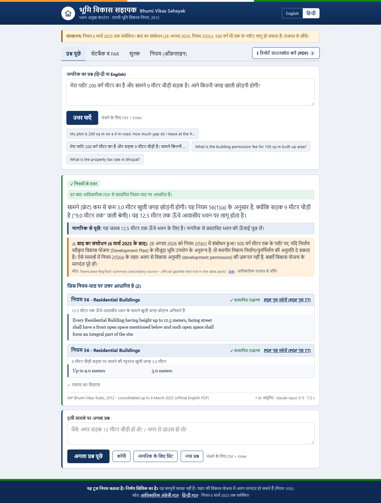
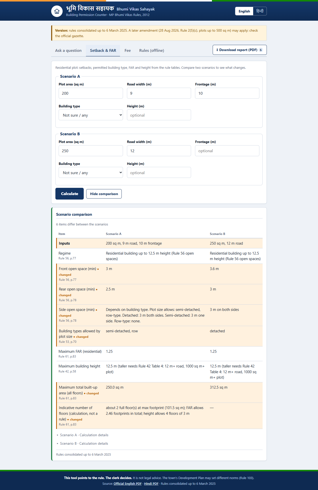
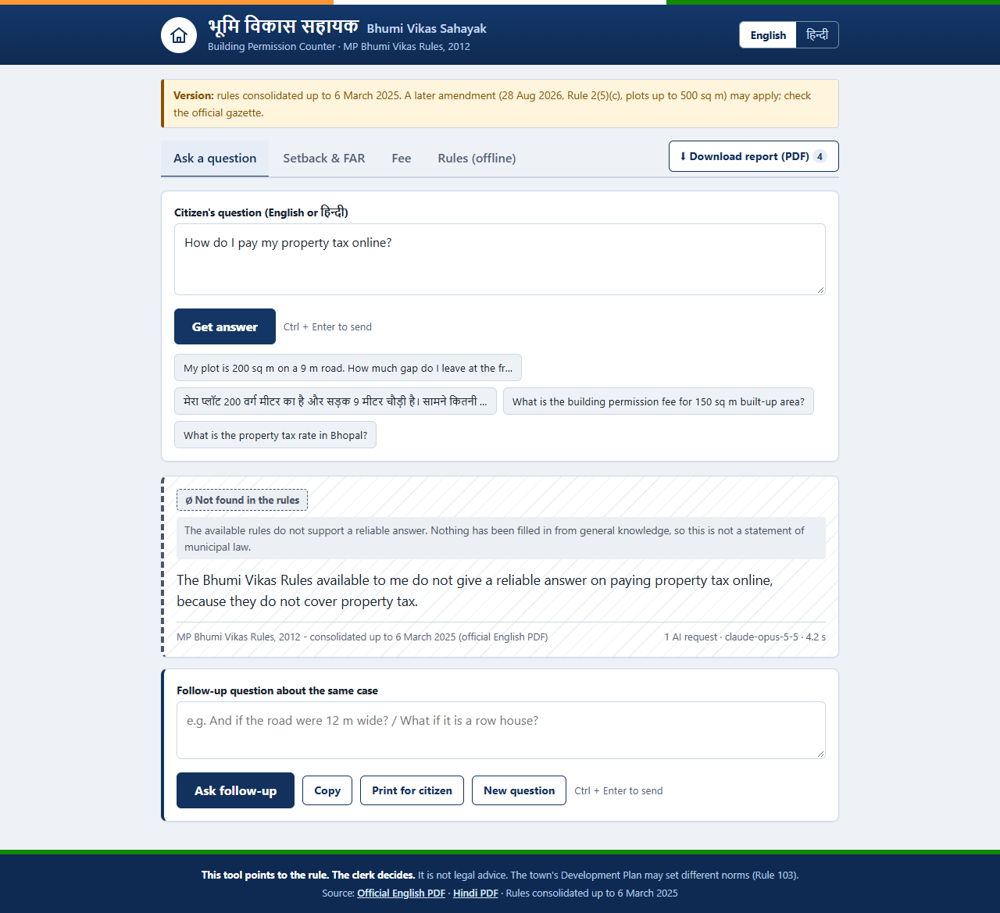
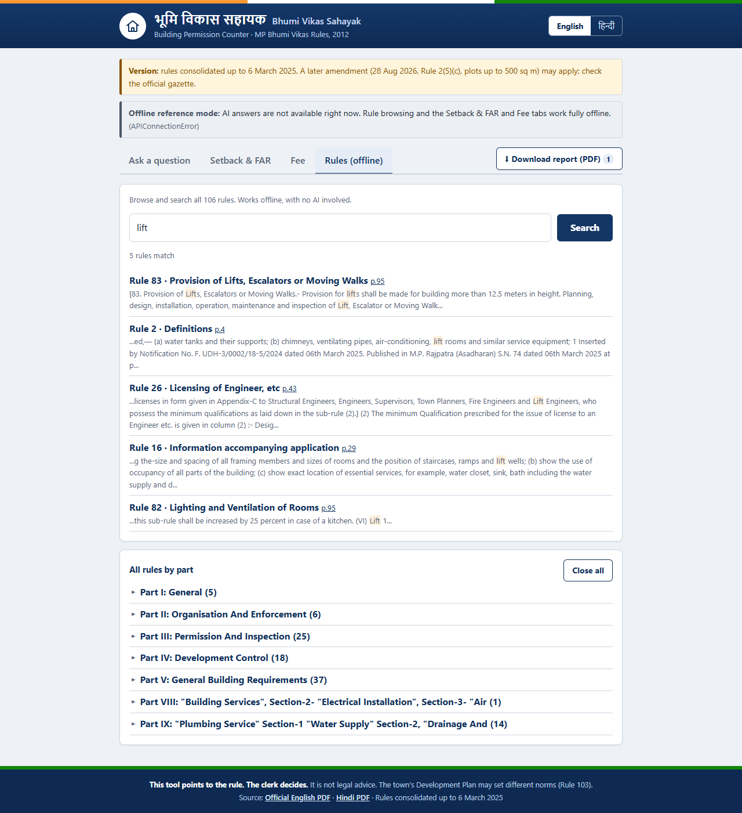
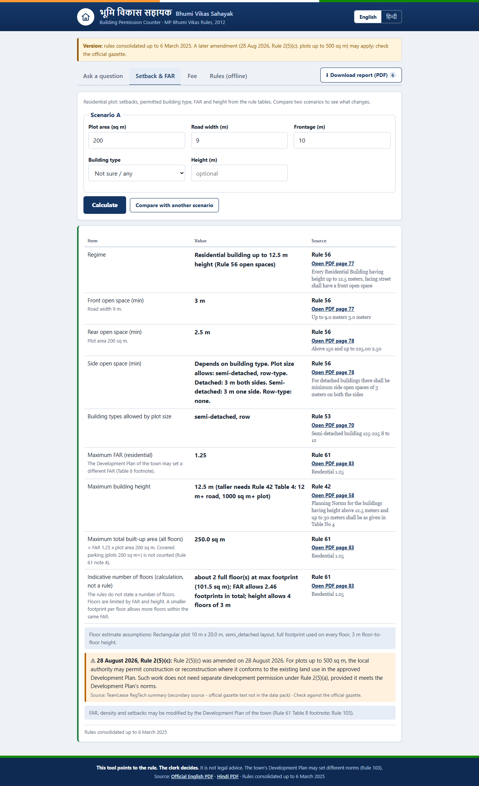
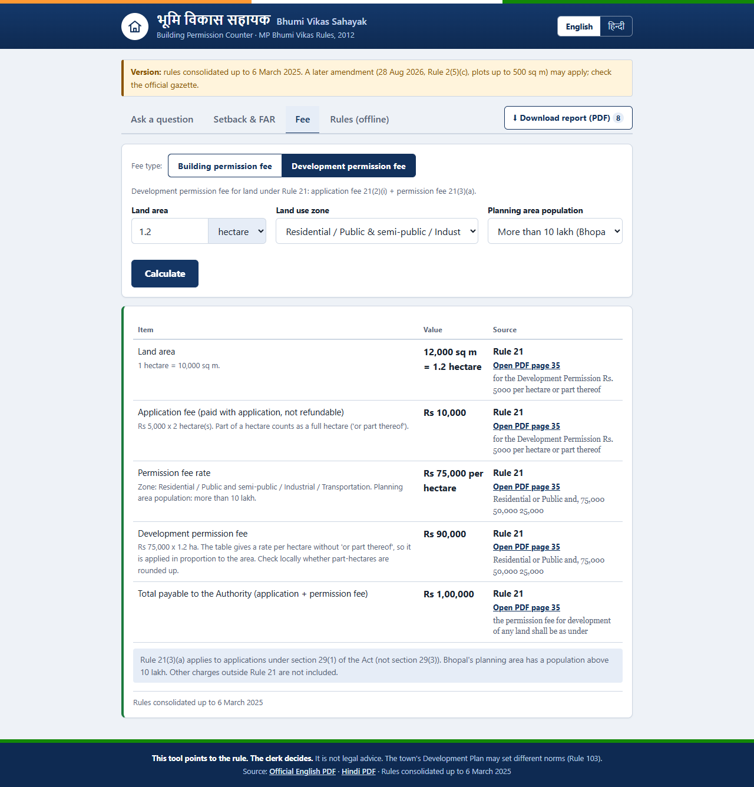

# Bhumi Vikas Sahayak · भूमि विकास सहायक

**Ask the Bhopal building rulebook, and get an answer you can trust.**

| | |
|---|---|
| **Team** | _<team name>_ |
| **Members** | _<name — role>, <name — role>, <name — role>, <name — role>_ |
| **Track** | Track 1: Bhumi Vikas Sahayak (Claude Impact Lab × Cerebras Café Compute, Bhopal, 11 Oct 2026) |
| **The one user** | A building-permission clerk at the Bhopal Municipal Corporation counter |

A citizen at the counter asks: *"My plot is 200 sq m on a 9 m road. How much gap do I leave at the front, how many floors can I build, and what fee do I pay?"*
The clerk types it in English or Hindi. In about 15–25 seconds they get:

- a **short answer in the same language**,
- the **rule number and the exact text** from the official rules, each quote **checked by a program** against the official text, with a link that **opens the PDF at that page**,
- **numbers from tables computed in code** (setbacks, FAR, fees), never by the AI,
- **which version of the rules** was used, plus a warning when a **later amendment** (28 Aug 2026, plots up to 500 sq m) may apply,
- four **visually distinct answer states**: ✓ answered from the rules (green), ◐ partly covered (amber), ∅ **not found in the rules** (grey, dashed), ✗ could not verify (red). "Not found" means the available rules do not support a reliable answer, and **nothing is filled in from general AI knowledge**,
- **⬇ Download report (PDF)** at the top: one click puts everything from the session into one PDF (a case summary, every question and answer with its verified quotes, Setback & FAR with any scenario comparison, building and development fees, and every rule passage used). Hindi is shaped correctly,
- **compare two scenarios** in the Setback & FAR tab, highlighting what changes when road width, plot area, frontage, building type or height changes,
- **inputs checked against the rules while the clerk types**: invalid or out-of-limit values are highlighted with the rule that sets the limit (e.g. height above what Rule 42 allows for that road and plot, or a building type that doesn't fit the plot under Rule 53), and Calculate stays disabled until they're fixed,
- **follow-up questions** about the same case (e.g. *"And if the road were 12 m wide?"*), which keep the context of the earlier questions in the conversation,
- a **Print for citizen** slip showing the whole conversation with each rule and quote,
- an **English / हिन्दी** switch for the whole interface.



## How to run it (5 steps)

1. Install Python 3.10+ and download this repo.
2. `pip install -r requirements.txt`
3. Set your Claude API key: `set ANTHROPIC_API_KEY=sk-ant-...` (Windows) or `export ANTHROPIC_API_KEY=sk-ant-...` (Mac/Linux). You can also copy `.env.example` to `.env` and use `run.bat`.
4. `python -m app.server` (on Windows you can double-click `run.bat` instead)
5. Open **http://localhost:8000**

**Offline reference mode:** the Setback & FAR tab (with Compare), the Fee tab, the PDF report, the **Rules** tab (browse all 106 rules by part, keyword search, full rule text) and the PDF links all work **without an API key or internet**. The page checks whether the AI is reachable (a free Models API call, no tokens). If it isn't, the page shows an "Offline reference mode" banner, and the Ask box points the clerk to the offline tabs instead of failing.

## How it works: why the answers can be trusted

```
question (EN/HI, + earlier turns for follow-ups)
   │
   ▼  app/router.py - plain Python, no AI
   reads inputs: plot area, road width, height, frontage, built-up area, land area, use/zone
   (feet, sq ft, gaj, acre converted in code; "10 m wide street, 9 m tall" → road 10, height 9)
   │
   ├─ inputs known ─────────► run calculators (app/calculators.py, tables checked against official text)
   │                          ──► ONE Claude request, tools disabled: explain + cite the computed evidence
   │
   ├─ inputs ambiguous ─────► Claude is told what could not be read ("30x40 - feet or metres?")
   │  (never guessed)          and asks the clerk to confirm; answers only what doesn't depend on it
   │
   └─ no calculation applies / inputs missing ──► Claude with the whole rulebook (cached prompt) and the
                                                   calculator tools, used only if it can find the inputs
   │
   ▼  programmatic verification (app/rules.py, app/support.py)
   • every quote must exist verbatim in the cited rule → else REJECTED (never shown as support)
   • every figure in the answer (m, sq m, Rs, %, years …) must appear in the verified rule text,
     the calculator results or the question → else the answer is marked "Could not verify"
   • "not found" answers carry no citations and no outside advice
   • amendments overlay (app/amendments.py) → version label + warnings
```

| Jury criterion | How we meet it |
|---|---|
| Every answer shows its rule number and source text | Citations are required. Each quote is matched verbatim (ignoring whitespace) against `data/bhumi_vikas_rules.jsonl`, and the PDF page is taken from the running headers. |
| Says "not found" and never invents a rule | The AI is instructed never to fill gaps with general knowledge: no offices, portals, procedures or rates, even if labelled "outside the rules". A `not_found` answer is stripped of citations in code and shown in its own grey, dashed style with "nothing has been filled in from general knowledge". The eval checks "not found" answers for gap-filling. A quote that isn't in the official text cannot pass as verified. |
| Table numbers (fees, setbacks) are right | The tables are encoded in `app/calculators.py`. On start-up, `self_check()` confirms every encoded row appears verbatim in the official text, and the server refuses to start otherwise. Boundary cases are unit-tested. |
| Shows how often it is right | `python -m eval.run_eval` runs the 17 sample questions. Results are in [`eval/REPORT.md`](eval/REPORT.md). |
| Which version of the rules | Banner and footer on every answer: *consolidated up to 6 March 2025*. Later amendments are listed with their source and status. |

## How often it is right

Results on the 17 official sample questions (`resources/sample_questions.md`), with `claude-opus-5-5` at medium effort:

| Metric | Result |
|---|---|
| Questions fully correct (all checks) | **17/17** |
| Correct rule cited (with verified quote) | 15/15 |
| Key numbers/facts present in the answer | 17/17 |
| Out-of-scope questions answered "not found" | 2/2 |
| In-scope questions wrongly answered "not found" | 0 |
| Quotes verified verbatim against the official text | 67/67 |
| Answers with a figure not found in the evidence | 0 |
| Claude API requests for the 17 questions | 17 (one per question; 3 precomputed in Python) |
| Largest answer / limit | 2,265 / 6,000 output tokens, none cut off |
| Median time per answer | 13.7 s (a repeated question: about 0.2 s from the answer cache) |

We ran the eval eight times; the latest run used `max_tokens` 6,000, and the answer cache is switched off during the eval so it measures real answers. In the latest run, the setback questions (Q1, Q10, Q14) are computed in Python first and answered with a single request each: 7.0 s, 5.0 s and 9.1 s, down from 18.1 s, 23.1 s and 14.7 s when Claude had to call the calculator itself. That is 17 requests in total instead of 20. Before this change, Q1 also made up a 200 sq m plot area to call the calculator; now it answers the front space from the road width and asks for the plot area. Earlier runs: one added a stricter check that "not found" answers carry no citations and no outside advice. An earlier answer that told the clerk to "send the citizen to the BMC property tax section" now fails that check, and the AI instructions were tightened so it no longer does this. Two early runs each had one failure, and in both cases our checker was wrong, not the answer:
- One quote rejoined a PDF line-break hyphen ("built-\nup" written as "built-up"). The verifier now ignores whitespace after a hyphen, and there's a test for it.
- One answer said "twice" where the grading pattern expected "two". The pattern now accepts "twice".

The answers themselves were correct each time.

Each question has a gold answer (`eval/gold.json`) checked by hand against the official PDF. A question passes only if the expected rule appears among the *verified* citations, the key numbers (such as 3.6 m or 0.40 ha) appear in the answer, Hindi questions get Hindi answers, every quote verifies, and the amendment is flagged where expected (Q11). We also checked by hand the claims that went beyond the gold answers: Rule 35's sixty days, Rule 83's six-monthly audit and 24-hour accident report, the High Court note under Rule 26, and Rule 12's composite-scheme sentence. 17 questions is a small set, so add your own real counter questions to `eval/gold.json`.

Offline tests: `python -m pytest tests` (25 tests, including input limits (Rules 42, 53), the answer cache and the PDF report, plus quote verification, every table boundary, building and development fees, input extraction and routing (English, Hindi, unit conversion, ambiguity, follow-ups), and the unsupported-figure check).
UI test: with the server running, `python tools/ui_smoke.py` drives the real page in Edge. It runs 43 checks. They cover: a setback + floors + fee question answered with a single AI request; verified quotes; the amendment warning; a follow-up question; closing opened panels (Close button and Esc); Hindi; the distinct "not found" state; the answer cache; input validation (Rule 42 height, Rule 53 building type, negative and zero values); both calculators and the scenario comparison; the PDF download; rule search and browse; and no JavaScript errors. It also saves the downloaded report as `docs/sample-report.pdf`. If a second server is running on port 8001 with the AI unreachable (`ANTHROPIC_BASE_URL=http://127.0.0.1:9 PORT=8001 python -m app.server`), it also tests offline reference mode end to end. It also retakes the screenshots.

## What works and what doesn't

**Works**
- English and Hindi questions, with answers in the same language (Devanagari).
- Verified rule quotes with PDF page links, plus correction of wrong rule numbers.
- Residential setbacks (Rule 56), building types by plot size (Rule 53), FAR (Rule 61), height regimes (Rule 42 Tables 4 and 5), and Rule 21 fees, all computed in code. The Fee tab has a toggle between the **building permission fee** (21(2)(ii) + 21(3)(b)/(c), by built-up area and use) and the **development permission fee** (21(2)(i) + 21(3)(a), by land area in sq m, hectares or acres, land use zone and planning-area population). The AI uses the same calculators when it answers fee questions.
- "Not found" for questions outside the rules (property tax, land rates), with no gap-filling.
- One-click PDF report of the whole session (works offline), and scenario comparison in the Setback & FAR tab.
- Input validation against the rulebook's limits, checked on the server, with messages in English and Hindi.
- Answer cache: a repeated question returns the stored, verified answer in about 0.2 s instead of 10–20 s. It's kept in memory and in `cache/answers.jsonl`, and invalidated automatically when the rules, model or AI instructions change. Only good answers are stored, never errors or unverified ones. Turn it off with `BVS_CACHE=0`.
- Offline reference mode: rule browsing and search, the calculators and the PDF report all work without the AI or internet. Rule texts are also cached by the browser.
- Asks the clerk for missing inputs (for example, built-up area for a fee).
- Follow-up questions. The last 4 question-and-answer pairs are sent as context, each follow-up is verified again against the rulebook, and **New question** starts a fresh conversation.
- Copy, a print-for-citizen slip, a Close button on every panel that opens (and Esc), and deep links (`/?q=...`, `/?tab=fee`, `/?tab=fee&fee=development`).

**Limits (please read)**
- **Part names in the rules data:** the data pack labels Rules 92–105 with the Part IX heading, so the Rules tab groups them under it. The rule texts themselves are correct.
- **28 Aug 2026 amendment to Rule 2(5)(c):** the official gazette text was not in the data pack. We use a secondary summary ([TeamLease RegTech](https://teamleaseregtech.com/updates/article/59469/government-of-madhya-pradesh-amendment-to-land-development-rules)) and always label it "check against the official gazette". When the gazette text is available, update `app/amendments.py`.
- **Quotes are in English.** The official Hindi PDF uses a legacy font that can't be parsed, so quotes come from the English PDF (the source of truth). Answers are in Hindi when asked in Hindi. The Hindi PDF is linked but not page-matched.
- **Floors:** the rules don't state a number of floors. The tool gives the maximum built-up area (FAR) and height cap, plus an *indicative* floor estimate with its assumptions stated.
- **Development Plan:** Bhopal's Development Plan can set different FAR, density or setbacks (Rule 61 footnote, Rule 103). That plan is not in the data pack, so the tool flags this rather than applying it.
- **Development fee rounding:** the application fee is charged per hectare "or part thereof" (so 1.2 ha counts as 2 ha). The permission fee table only says "Rs./Hectare", so the tool charges it in proportion to the area and says so on screen. Check whether your office rounds part-hectares up.
- **Calculators cover residential plots and Rule 21 fees only.** Commercial setbacks (Rule 57), group housing, industrial plots and so on are answered from the rule text by the AI, without a calculator.
- **Fee slabs:** the table lists whole numbers (0–75, 76–125 …), so an area like 75.5 sq m is read as "above 75 up to 125". The tool says so in the answer. Municipal charges outside Rule 21 are not included.
- **Input reading is rule-based.** The router understands common English and Hindi phrasings and units. Anything it can't read safely goes to the AI path, which asks rather than guesses. Unusual phrasings may take the slower tool path, but the answer is still verified.
- **The figure check confirms that each number exists in the evidence, not that it is attached to the right item.** For example, "4 m" passes if a cited rule contains 4.0 somewhere. The key numbers (setbacks, FAR, fees) come from the calculators, so they are exact.
- **PDF fonts:** Hindi in the PDF needs a Devanagari font. On Windows, the built-in Nirmala UI is used. On other systems, install Noto Sans Devanagari or set `BVS_PDF_FONT`; without one, the PDF is still produced but Hindi text can't be shown.
- **The answer cache stores questions on the server machine** (in `cache/answers.jsonl`, which is excluded from git). Delete the file to clear it, or set `BVS_CACHE=0`.
- Needs internet and a Claude API key for questions. At current Opus 5.5 prices, a question costs roughly US$0.05–0.10 once the rulebook prompt is cached. The first question each hour pays about US$0.75 to write the cache (1-hour cache). `BVS_EFFORT=low` is faster and cheaper.
- Not legal advice. The tool points to the rule, and the clerk decides.

## Data used

All data comes from the hackathon pack (`data/`, `resources/`):
- `data/bhumi_vikas_rules.jsonl`: the 106 rules (source of the rulebook prompt and quote verification)
- `resources/MP_Bhumi_Vikas_Rules_2012_upto_2025-03-06_EN.pdf`: the official English PDF, served for page links ([source](https://mptownplan.gov.in/NewsPDF/bvn06032025E.pdf))
- `resources/MP_Bhumi_Vikas_Rules_2012_upto_2025-03-06_HI.pdf`: the official Hindi PDF ([source](https://mptownplan.gov.in/NewsPDF/bvn06032025H.pdf))
- `resources/sample_questions.md`: the test questions

Extra public data: the summary of the **28 Aug 2026 amendment to Rule 2(5)(c)** from [TeamLease RegTech](https://teamleaseregtech.com/updates/article/59469/government-of-madhya-pradesh-amendment-to-land-development-rules) (read 11 Oct 2026). We used no live government systems and no personal data.

## Project layout

```
app/rules.py         load rules, strip page headers, map text → PDF page, verify quotes, offline keyword search
app/calculators.py   setback / FAR / height / fee tables (self-checked against official text), case summary
app/validate.py      input limits from the rules (Rule 42 height, Rule 53 building type) + basic validity
app/report.py        the session PDF (fpdf2 + HarfBuzz for Hindi; recomputes calculations, re-verifies quotes)
app/cache.py         answer cache (memory + cache/answers.jsonl)
app/amendments.py    changes after 6 Mar 2025, with source and status
app/router.py        reads inputs from the question in Python, decides which calculators apply, flags ambiguity
app/support.py       checks every figure in an answer against the evidence
app/assistant.py     Claude call: precomputed (1 request) or tool path; cached rulebook prompt; JSON answer; verification
app/server.py        FastAPI: /api/ask, /api/report (PDF), /api/validate/{form}, /api/calc/plot, /api/calc/fee, /api/calc/devfee,
                     /api/search, /api/rules, /api/rule/{n}, /api/status (AI reachable?), /pdf/en
static/index.html    the clerk's page: one file, plain HTML/CSS/JS, English/हिन्दी, no build step
eval/                gold answers, eval runner, REPORT.md, results.json
tests/               offline unit tests
tools/ui_smoke.py    end-to-end UI test in Edge (43 checks incl. validation, PDF download, compare, offline mode) + screenshots
```

Configuration (environment variables): `ANTHROPIC_API_KEY` (required for questions), `BVS_MODEL` (default `claude-opus-5-5`), `BVS_EFFORT` (`low`/`medium`/`high`, default `medium`), `PORT`, `HOST`. No keys are stored in the code.

## Screenshots

| Follow-up question | Hindi question |
|---|---|
|  |  |

| Compare two scenarios | Not in the rules | Sample PDF report |
|---|---|---|
|  |  | [docs/sample-report.pdf](docs/sample-report.pdf) |

| Offline reference mode | Calculator | Development fee |
|---|---|---|
|  |  |  |

## License

MIT. See [LICENSE](LICENSE). Offered to the Government of Madhya Pradesh through MPSeDC.
